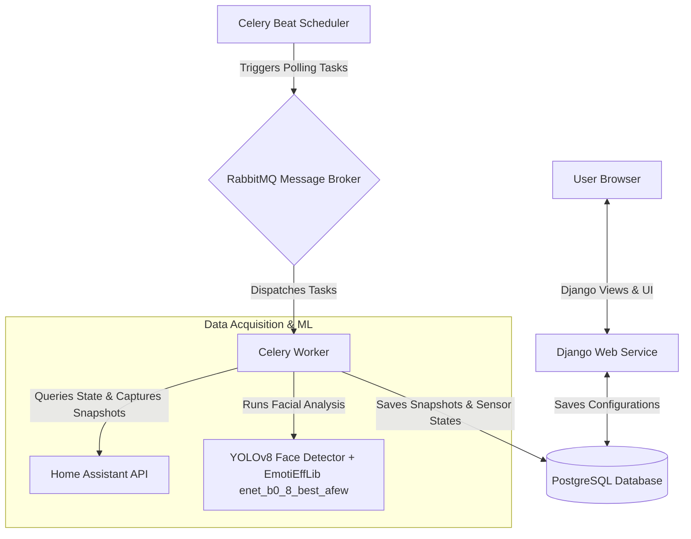

# SHERE - Smart Home Emotion Research Engine

SHERE (Smart Home Emotion Research Engine) is an advanced Django-based research framework designed to study the correlations between user emotional states and domestic environments. By integrating directly with Home Assistant (HA), SHERE captures real-time smart home device states (such as lighting levels, room temperatures, and media player activity) alongside user facial emotions analyzed from home cameras.

This data provides researchers and smart home enthusiasts with empirical logs to design and evaluate emotional-aware ambient intelligence and adaptive automation.

---

## 🌟 Key Features

*   **🔒 Secure Credentials Store**: Sensitive Long-Lived Access Tokens (LLAT) for Home Assistant are encrypted using symmetric Fernet encryption (`cryptography`) before being persisted in the database.
*   **🧠 Dual-Backend Emotion Detection**: Uses the **EmotiEffLib / HSEmotion** `enet_b0_8_best_afew` model (EfficientNet-B0, 8 emotion classes) by default [[1]](#-references)[[2]](#-references), with **HuggingFace Transformers** available as an alternative backend — combined with **YOLOv8** (`arnabdhar/YOLOv8-Face-Detection`) for face detection. Switch backends and models at any time via environment variables.
*   **⏱️ Distributed Periodic Polling**: Automated heartbeat checks driven by **Celery** and **Celery Beat** run every 30 seconds to query device states and camera frames in parallel, preventing UI blocking.
*   **📊 Unified Data Analysis Matrix**: A comprehensive dashboard showing historical poll cycles aligning camera snapshots with concurrent smart entity states.
*   **📥 CSV Exporter**: Export the unified database logs with a single click to perform data modeling, statistical correlation, or train predictive models.
*   **🔌 Plug-and-Play Configuration**: Add and edit cameras or entities dynamically via the configuration UI.

---

## 🏗️ System Architecture

The following diagram illustrates how SHERE orchestrates the web dashboard, background workers, databases, and the external Home Assistant API:



---

## 🛠️ Technology Stack

*   **Backend Framework**: [Django](https://www.djangoproject.com/)
*   **Task Queue & Scheduling**: [Celery](https://docs.celeryq.dev/) & [django-celery-beat](https://github.com/celery/django-celery-beat)
*   **Message Broker**: [RabbitMQ](https://www.rabbitmq.com/)
*   **Database**: [PostgreSQL 15](https://www.postgresql.org/)
*   **Computer Vision**: [OpenCV Headless](https://github.com/opencv/opencv-python)
*   **Deep Learning**: [PyTorch](https://pytorch.org/), [EmotiEffLib / HSEmotion](https://github.com/sb-ai-lab/EmotiEffLib), [HuggingFace Transformers](https://huggingface.co/transformers/), & [YOLOv8](https://github.com/ultralytics/ultralytics)
*   **Cryptography**: [Fernet (Cryptography)](https://cryptography.io/)
*   **Containerization**: Docker & Docker Compose

---

## ⚙️ Database Schema & Models

SHERE maps the research data using a structured relational model:

### `HomeAssistantCredentials`
Stores the connection coordinates and authentication tokens.
*   `user`: Django Auth user owner.
*   `host` / `port`: Coordinates of the Home Assistant instance.
*   `encrypted_token` (Write-only): The access token encrypted using `cryptography.fernet`. Plaintext tokens are never stored directly.

### `PollCycle`
Acts as the central timeline heartbeat. Every periodic run generates a new `PollCycle` with a timestamp to group snapshots and entity states together.

### `Entity`
Defines the Home Assistant entities to track (e.g., `sensor.living_room_temperature`, `light.kitchen_lights`).
*   `entity_id`: The exact Home Assistant identifier.
*   `name`: A friendly name for display.
*   `location`: Physical room or area.
*   `unit_of_measurement`: Optional unit (e.g. `°C`, `%`).

### `EntityStatus`
A time-series entry representing the state of an `Entity` at a specific `PollCycle`.

### `Camera`
Defines registered cameras to query frames from.
*   `camera_id`: The exact Home Assistant camera entity identifier (e.g., `camera.living_room`).

### `CameraSnapshot`
Stores the image captured at a specific `PollCycle` alongside its analytical results.
*   `image`: Path to the saved image in Django's media storage.
*   `detected_emotion`: The primary emotion classification returned by the model.
*   `confidence_score`: A normalized value (0.0 to 1.0) indicating the model's prediction confidence.

---

## 💻 System Requirements

Before deploying SHERE, ensure your host environment meets the following minimum requirements:

*   **Software**: [Docker](https://www.docker.com/) with [Docker Compose](https://docs.docker.com/compose/)
*   **Architecture**: x86_64 / x64 CPU
*   **Processor**: Dual-core CPU (2 Cores minimum)
*   **Memory**: 4 GB RAM minimum
*   **Network & Connectivity**: Accessible Home Assistant instance with exposed REST API (and a valid Long-Lived Access Token)
*   **Optional GPU Acceleration**: An NVIDIA graphics card (e.g. RTX series) can be passed through to accelerate deep learning model inference. To enable GPU support:
    1. Install proper NVIDIA host drivers.
    2. Install `nvidia-container-toolkit` on the host machine.
    3. Uncomment the NVIDIA GPU `deploy` block in `docker-compose.yml` under the `celery_worker` service.

---

## 📈 Performance Benchmarks

SHERE was benchmarked with the default models (YOLOv8 face detector + EmotiEffLib `enet_b0_8_best_afew`) on four hardware configurations, each with 1, 2, 4 and 8 cameras in a single poll cycle.

**Test setup:**
*   **Cameras:** Ubiquiti G5 Turret Ultra, 4MP snapshots (2688×1512).
*   **Faces:** the cameras covered different areas of the home, so only one frame per cycle contained a face. Face detection ran on every frame; emotion classification ran once per cycle.
*   **Home Assistant:** one instance on a Raspberry Pi 4, connected over 1 Gb/s Ethernet (the laptop used Wi-Fi 6).
*   **API window:** time between the first and last HA API request in a cycle (when all snapshots and sensor states are retrieved). The **full cycle** also includes inference and database commits.

| Hardware | Cameras | Emotion Classification [ms] | Face Detection [ms] | API Window [ms] | Full Cycle [ms] |
| :--- | :---: | ---: | ---: | ---: | ---: |
| **Ultra-Low-Power Edge**<br>HP t630 (AMD GX-420GI, 32 GB DDR4) | 1 | 244 | 340 | 385 | 992 |
| | 2 | 280 | 708 | 949 | 1593 |
| | 4 | 223 | 1384 | 2366 | 2952 |
| | 8 | 207 | 2757 | 5355 | 5928 |
| **Mobile Workstation**<br>Laptop (Intel Core Ultra 5 125H, 64 GB DDR5) | 1 | 53 | 95 | 418 | 578 |
| | 2 | 49 | 182 | 1023 | 1178 |
| | 4 | 50 | 356 | 2115 | 2271 |
| | 8 | 68 | 721 | 4418 | 4593 |
| **Mid-Range Desktop**<br>Ryzen 5 4500, 64 GB DDR4, RTX 3060 12 GB | 1 | 27 | 37 | 216 | 286 |
| | 2 | 27 | 73 | 494 | 563 |
| | 4 | 27 | 143 | 992 | 1061 |
| | 8 | 27 | 286 | 1963 | 2033 |
| **High-End Workstation**<br>Ryzen 9 7950X, 192 GB DDR5, RTX 5090 32 GB | 1 | 14 | 17 | 305 | 339 |
| | 2 | 15 | 36 | 615 | 650 |
| | 4 | 14 | 70 | 1124 | 1160 |
| | 8 | 14 | 135 | 1974 | 2009 |

**Key findings:**
*   **Low-power hardware is enough:** a fanless HP t630 thin client completes a single-camera cycle in under 1 s (992 ms).
*   **GPU gives the biggest jump:** model inference (detection + classification) drops from 584 ms on the thin client to 64 ms on an RTX 3060. Beyond that, returns diminish because network and I/O overhead dominates. A mid-range PC offers the best price-to-performance.
*   **Linear scaling with cameras:** each extra camera adds roughly 0.70 s (HP t630), 0.57 s (laptop) and 0.24–0.25 s (GPU workstations). An 8-camera cycle takes about 2 s on GPU hosts and under 6 s on the thin client.
*   **Emotion classification time grows with faces, not cameras:** it stayed nearly constant here because only one frame per cycle had a face. Expect it to grow if several cameras see faces at once.
*   **Temporal offset:** snapshots are fetched sequentially through the HA proxy, so frames and sensor states within one cycle are not captured at exactly the same instant. The API window is the upper bound for this offset: about 0.2 s (1 camera, GPU workstation) up to 5.3 s (8 cameras, thin client). For tighter alignment, use fewer cameras per cycle or faster hardware.
*   **Concurrency:** increase `CELERY_WORKER_CONCURRENCY` to scale throughput. With the default models each worker uses about 1 GB of VRAM, so an RTX 3060 (12 GB) supports up to ~10 workers and an RTX 5090 (32 GB) about 30.
*   **Cold start:** the first poll cycle loads the YOLOv8 and EfficientNet-B0 weights. This takes several seconds on modern workstations and up to 30 s on ultra-low-power nodes.

> [!NOTE]
> These timings are specific to the tested environment. Results will vary with camera resolution and encoding, network type (Wi-Fi vs. wired), Home Assistant host load and camera firmware. Run the built-in diagnostic test on the **Run** tab on your own hardware before choosing a sampling interval.

---

## 🚀 Quick Start & Installation

Ensure you have [Docker](https://www.docker.com/) and [Docker Compose](https://docs.docker.com/compose/) installed.

### ⚡ Fast Preview (Without Home Assistant)

The easiest way to see and test the application without a live Home Assistant setup is to run:

```bash
MOCK_HA=true docker compose up
```

This automatically launches a built-in mock Home Assistant server populated with sample sensor data and mock camera snapshots so you can immediately explore the app's full capabilities.

### 🛠️ Standard Setup (With Home Assistant)

If you have a Home Assistant setup, simply running `docker compose up` is enough:

```bash
docker compose up -d
```

This will run the core background services:
*   `db`: PostgreSQL database server.
*   `rabbitmq`: The message broker queue.
*   `web`: The Django web portal (accessible at `http://localhost:8000`).
*   `celery_worker`: Background process handler carrying out API requests and deep learning tasks.
*   `celery_beat`: Cron scheduler dispatching tasks every 30 seconds.

> [!IMPORTANT]
> **Security Notice**: Creating a `.env` file is optional because fallback default values are built-in for zero-configuration startup. However, **it is still strongly advised to set environment variables for security reasons** in non-isolated or production deployments.

#### Environment Variables

The following environment variables can be customized:

| Variable | Description | Default |
| :--- | :--- | :--- |
| `MOCK_HA` | Enable mock Home Assistant server for fast previewing | `false` |
| `DB_USER` | PostgreSQL database user | `admin` |
| `DB_PASSWORD` | PostgreSQL database password | `admin123` |
| `DB_HOST` | Database host address | `127.0.0.1` |
| `RABBIT_USER` | RabbitMQ broker username | `guest` |
| `RABBIT_PASSWORD` | RabbitMQ broker password | `guest` |
| `ENCRYPTION_KEY` | Symmetric Fernet key for encrypting stored access tokens | Built-in default key |
| `APP_USER` | Initial Django admin username created on startup | `admin` |
| `APP_PASS` | Initial Django admin password created on startup | `admin123` |
| `EMOTION_MODEL_BACKEND` | Emotion recognition backend: `emotiefflib` or `dima` | `emotiefflib` |
| `EMOTION_MODEL_NAME` | Model name used by the selected backend (see section below) | `enet_b0_8_best_afew` |
| `FACE_DETECTOR_MODEL_NAME` | HuggingFace repo for the YOLO face detector | `arnabdhar/YOLOv8-Face-Detection` |
| `PHOTO_FILE_POLICY` | Which snapshot image files are kept on disk: `all`, `emotions` or `none` (see [Snapshot File Retention](#-snapshot-file-retention)) | `none` |
| `CELERY_WORKER_CONCURRENCY` | Celery worker process concurrency | `2` |
| `DOCKER_IMAGE` | SHERE container image registry path | `ghcr.io/adrian-wozniak-wat/shere:latest` |

#### Example `.env` File:

```env
# Database & Broker Credentials
DB_USER=custom_db_user
DB_PASSWORD=custom_db_password
RABBIT_USER=custom_rabbit_user
RABBIT_PASSWORD=custom_rabbit_password

# Secret Fernet Encryption Key
# Generate using: python3 -c "from cryptography.fernet import Fernet; print(Fernet.generate_key().decode())"
ENCRYPTION_KEY=your-custom-generated-fernet-key

# Application Superuser Credentials
APP_USER=custom_admin
APP_PASS=custom_admin_password

# Optional Performance & Image Settings
CELERY_WORKER_CONCURRENCY=2
DOCKER_IMAGE=ghcr.io/adrian-wozniak-wat/shere:latest

# Snapshot file retention: all | emotions | none
PHOTO_FILE_POLICY=none
```

### 2. Create a Superuser (Optional/Manual)
The `web` container automatically creates a superuser on startup using `APP_USER` and `APP_PASS` (defaulting to `admin` / `admin123`). If you wish to manually create additional admin accounts, run:

```bash
docker compose exec web python src/manage.py createsuperuser
```

### 3. Verify the App Status
Access `http://localhost:8000` in your web browser, log in using your superuser credentials, navigate to the **Run** tab, and execute the connection diagnostic suite to verify API credentials, sensor bindings, and model availability.

---

## 🖼️ Snapshot File Retention

The `PHOTO_FILE_POLICY` environment variable controls whether camera snapshot images (and their `_face_cropped` face crops) are kept on disk after each poll cycle. Emotion analysis always runs on the downloaded frame first; the policy is applied afterwards, so emotion labels, confidence scores and entity states are recorded in the database regardless of the setting.

| Value | Behaviour |
| :--- | :--- |
| `none` (default) | **Privacy-first.** All image files are deleted right after analysis. Only the analysis results are stored. |
| `emotions` | Images are kept only when emotion recognition was performed (a face was detected and classified). Frames without a face are deleted. |
| `all` | Every snapshot and face crop is kept, whether or not a face was found. Uses the most disk space. |

When a file is deleted, the `image` field of the corresponding `CameraSnapshot` is left empty, so no image is shown for it in the dashboard. Values are case-insensitive. Any unrecognised value falls back to `none` and logs a warning.

**How to set it:** add it to your `.env` file (or export it in your shell), then restart the containers:

```env
PHOTO_FILE_POLICY=emotions
```

```bash
docker compose up -d
```

> [!WARNING]
> Setting `all` or `emotions` stores images of household members on disk. Make sure you have the participants' consent and that this complies with applicable data-protection rules (e.g. GDPR).

---

## 🧠 Changing Emotion Models

SHERE supports two interchangeable emotion recognition backends, selected through the `EMOTION_MODEL_BACKEND` environment variable. Both backends share the same YOLO face detector and expose their result through an identical interface, so switching is seamless.

---

### Backend 1 — EmotiEffLib / HSEmotion (default)

`EMOTION_MODEL_BACKEND=emotiefflib`

Uses the [EmotiEffLib](https://github.com/sb-ai-lab/EmotiEffLib) (formerly HSEmotion) library — a lightweight, efficient emotion recognizer that supports ONNX and PyTorch inference backends.

The default model is **`enet_b0_8_best_afew`**: an EfficientNet-B0 network pre-trained on face identification (VGGFace2), fine-tuned on AffectNet for 8 emotion classes (anger, contempt, disgust, fear, happiness, neutral, sadness, surprise), with the checkpoint selected for best performance on the AFEW video emotion dataset. The model and its evaluation results are described in Savchenko et al. [[1]](#-references)[[2]](#-references). Its small size makes it suitable for CPU-only inference on modest home hardware.

Set `EMOTION_MODEL_NAME` to one of the built-in EmotiEffLib model identifiers:

| `EMOTION_MODEL_NAME` | Description |
| :--- | :--- |
| `enet_b0_8_best_afew` | **Default.** EfficientNet-B0, 8 classes, best checkpoint on AFEW — good general-purpose choice |
| `enet_b0_8_best_vgaf` | EfficientNet-B0 trained on VGAF — alternative general-purpose model |
| `enet_b0_8_va_mtl` | EfficientNet-B0 multi-task learning variant |
| `enet_b2_8` | EfficientNet-B2 — larger and more accurate, higher memory usage |
| `enet_b2_8_best` | Best-performing EfficientNet-B2 variant |

**Example `.env` (EmotiEffLib — default):**

```env
EMOTION_MODEL_BACKEND=emotiefflib
EMOTION_MODEL_NAME=enet_b0_8_best_afew
```

---

### Backend 2 — Dima / HuggingFace Transformers

`EMOTION_MODEL_BACKEND=dima`

Uses a standard HuggingFace `image-classification` pipeline. Any compatible model hosted on the [HuggingFace Hub](https://huggingface.co/models?pipeline_tag=image-classification) can be used by setting `EMOTION_MODEL_NAME` to its repository identifier.

| `EMOTION_MODEL_NAME` | Description |
| :--- | :--- |
| `dima806/facial_emotions_image_detection` | Original default — 7-class emotion classifier |
| Any `image-classification` HF repo | Provide the repo identifier in `owner/repo` format |

**Example `.env` (Dima/HuggingFace):**

```env
EMOTION_MODEL_BACKEND=dima
EMOTION_MODEL_NAME=dima806/facial_emotions_image_detection
```

---

### Applying the change

1. Edit your `.env` file (or set the variables in your shell):

   ```bash
   # Switch to EmotiEffLib with a specific model
   EMOTION_MODEL_BACKEND=emotiefflib
   EMOTION_MODEL_NAME=enet_b2_8_best
   ```

2. Rebuild and restart the containers so the new image downloads during startup:

   ```bash
   docker compose up --build
   ```

   The selected model is downloaded automatically on first use. Subsequent restarts reuse the cached model.

> [!TIP]
> The model is loaded lazily — it is only downloaded and initialised when the first emotion analysis task runs, not at container startup. Check the `celery_worker` logs to confirm which backend and model are active.

> [!NOTE]
> If `EMOTION_MODEL_BACKEND` is set to an unrecognised value, the system automatically falls back to `emotiefflib` and logs a warning.

---

## 📚 References

The default emotion recognition model (`enet_b0_8_best_afew`, EmotiEffLib / HSEmotion) and its reported results are described in:

1. A. V. Savchenko, "Facial Expression Recognition with Adaptive Frame Rate based on Multiple Testing Correction," in *Proceedings of the 40th International Conference on Machine Learning (ICML)*, PMLR vol. 202, pp. 30119–30129, 2023. [https://proceedings.mlr.press/v202/savchenko23a.html](https://proceedings.mlr.press/v202/savchenko23a.html)
2. A. V. Savchenko, L. V. Savchenko, and I. Makarov, "Classifying emotions and engagement in online learning based on a single facial expression recognition neural network," *IEEE Transactions on Affective Computing*, 2022. [https://ieeexplore.ieee.org/document/9815154](https://ieeexplore.ieee.org/document/9815154)

<details>
<summary>BibTeX</summary>

```bibtex
@inproceedings{savchenko2023facial,
  title     = {Facial Expression Recognition with Adaptive Frame Rate based on Multiple Testing Correction},
  author    = {Savchenko, Andrey},
  booktitle = {Proceedings of the 40th International Conference on Machine Learning (ICML)},
  pages     = {30119--30129},
  year      = {2023},
  editor    = {Krause, Andreas and Brunskill, Emma and Cho, Kyunghyun and Engelhardt, Barbara and Sabato, Sivan and Scarlett, Jonathan},
  volume    = {202},
  series    = {Proceedings of Machine Learning Research},
  month     = {23--29 Jul},
  publisher = {PMLR},
  url       = {https://proceedings.mlr.press/v202/savchenko23a.html}
}

@article{savchenko2022classifying,
  title     = {Classifying emotions and engagement in online learning based on a single facial expression recognition neural network},
  author    = {Savchenko, Andrey V and Savchenko, Lyudmila V and Makarov, Ilya},
  journal   = {IEEE Transactions on Affective Computing},
  year      = {2022},
  publisher = {IEEE},
  url       = {https://ieeexplore.ieee.org/document/9815154}
}
```

</details>

---

## 📧 Scientific Support & Contact

The author can provide full support with software setup, deployment, and data collection, especially when it comes to scientific and research purposes.

Additionally, for Home Assistant installations that are exposed to the internet, the author can host the application on remote infrastructure and deliver the compiled research results.

* **Contact Email**: [adrian.wozniak@wat.edu.pl](mailto:adrian.wozniak@wat.edu.pl)
